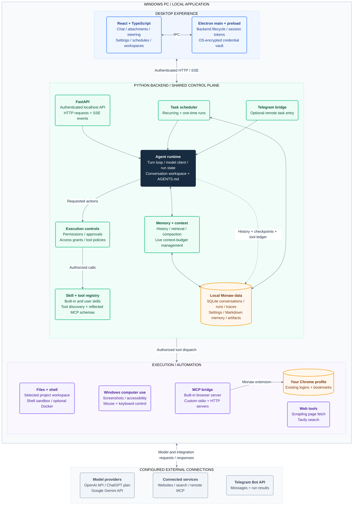

<p align="center">
  
</p>

<h1 align="center">Monaw Agent</h1>

<p align="center">
  <strong>Your AI assistant for files, browsers, and Windows apps.</strong><br />
  Work with your projects, automate everyday tasks, and connect your tools through one desktop chat.<br />
  Open source. Local storage. Your choice of model.
</p>

<p align="center">
  <a href="docs/installation.md"></a>
  <a href="#technology-stack"></a>
  <a href="#technology-stack"></a>
  <a href="backend/.python-version"></a>
  <a href="LICENSE"></a>
</p>

<p align="center">
  <a href="https://github.com/kailiang0120/monaw/releases/latest"><strong>Download for Windows (.exe)</strong></a> &middot;
  <a href="#getting-started">Getting started</a> &middot;
  <a href="#documentation">Documentation</a> &middot;
  <a href="#development">Development</a> &middot;
  <a href="https://github.com/kailiang0120/monaw/issues">Report an issue</a>
</p>

<p align="center">
  
  <br />
  <sub>From project files to browser tasks and desktop workflows. Illustration of Monaw's capabilities.</sub>
</p>

## What you can do

| Capability | What it means for you |
| --- | --- |
| **Work with files and code** | Read and edit project files, run shell commands, and give each conversation its own workspace and `AGENTS.md` instructions. |
| **Use your browser and desktop** | Automate Chrome through the Monaw extension and interact with Windows apps. [Browser automation](docs/browser-automation.md) · [Computer use](docs/computer-use.md) |
| **Choose your model** | Connect an OpenAI API key, sign in with your ChatGPT account, or use a Google Gemini API key. Switch providers and models from the chat composer. |
| **Keep context across tasks** | Save global preferences and workspace memory, and steer or stop an active task. [Memory guide](docs/memory.md) |
| **Connect and automate** | Add MCP tools, schedule tasks, and optionally send tasks through Telegram. [MCP](docs/mcp.md) · [Scheduling](docs/scheduling.md) · [Telegram](docs/telegram.md) |
| **Control how actions run** | Choose Default, Full Access, Auto Review, or Custom permissions, with separate sandbox settings. [Permissions](docs/permissions.md) · [Sandboxing](docs/sandboxing.md) |

Monaw runs on your PC. Chat history, settings, memory, and artifacts are stored locally; model requests go to your selected provider. The desktop app is available for Windows 10 and 11 (x64).

---

## Install for Windows

**[Download the latest Windows installer](https://github.com/kailiang0120/monaw/releases/latest)** — no Python, Node.js, Git, or source checkout required.

1. Open the latest release and download `Monaw-Setup-<version>-x64.exe` from **Assets**.
2. Check its SHA-256 checksum against the release notes, then run the installer. See the [installation guide](docs/installation.md#install) for the command and unsigned-installer instructions.
3. Open **Monaw** from the Windows Start menu and follow [Getting started](#getting-started) below.

You need Windows 10 or 11 (64-bit), an internet connection for model access, and a supported model connection. Google Chrome **125+** is needed for browser automation; Docker Desktop is optional for isolated shell execution.

The installer is currently unsigned. Updates are installed manually: download the new installer, close Monaw, and install it over the existing version. See the [installation guide](docs/installation.md) for upgrades, backups, and uninstalling. macOS and Linux builds are not available.

## Getting started

### 1. Connect a model

Open **Settings > Connections** and choose how you want to connect. Then select the provider, model, and reasoning effort in the chat composer.

| Connection | Setup |
| --- | --- |
| **ChatGPT account** | Choose **Continue with ChatGPT** and complete sign-in. Uses your ChatGPT plan, separately from API-key billing. |
| **OpenAI API** | Save your OpenAI API key. Uses your OpenAI API account. |
| **Google Gemini API** | Save your Google API key. Uses your Google API account. |

Configure connections in the app; no `.env` editing is required. Voice input needs an OpenAI or Google API key, even when chat uses a ChatGPT account.

### 2. Choose a workspace and permissions

Click **Default workspace** above the message box to choose the folder Monaw should work in. Choose **Default**, **Full Access**, **Auto Review**, or **Custom** permissions in Settings or the composer. See [permissions](docs/permissions.md) for how approvals work; sandbox settings are configured separately.

### 3. Try a first task

Use **Get started** in a new chat to check your connection, workspace, and permissions. Try a request such as:

> Look through this workspace and summarize what the project does without changing any files.

You can steer or stop Monaw while it works. For browser tasks, set up the Monaw Chrome extension under **Settings > Browser**.

### Optional integrations

| Service | Used for | Configuration |
| --- | --- | --- |
| **Tavily API** | Web search. | Tavily API key in Settings > Connections. |
| **Telegram Bot API** | Remote task input and results. | Bot token and allowed users/chats in Settings. |
| **MCP servers** | Additional local or remote tools. | Settings > Tools > MCP; supports stdio and Streamable HTTP. |

Browser profiles and allowed domains are configured under **Settings > Browser**. See the [documentation](#documentation) for memory, scheduling, Telegram, and other workflows.

## Workspaces, Memory, and Local Data

Each conversation can use its own project folder. That workspace determines relative file paths, command locations, and project `AGENTS.md` instructions. Change it while the agent is idle, or reset it to the default workspace.

Memory has two scopes: **global** for your preferences and **workspace** for project context. Manage it under **Settings > Identity**. See the [memory guide](docs/memory.md).

Your data lives under `%USERPROFILE%\.monaw` by default, separately from the installed app. This includes conversations, settings, memory, logs, and artifacts. Saved provider keys and the Telegram token are encrypted using Windows data protection. Your Chrome profile stays in Chrome's own folder.

Use **Settings > Storage** to inspect and manage local data. See [operations](docs/operations.md) for backups, data-folder overrides, retention, and security details.

## Troubleshooting

| Problem | What to do |
| --- | --- |
| Windows warns about the installer | The installer is unsigned. Check the release checksum and follow the [installation guide](docs/installation.md#install). |
| The installed app does not start | Check `%USERPROFILE%\.monaw\runtime\backend.log` and the [startup troubleshooting guide](docs/installation.md#if-monaw-does-not-start). |
| Browser automation cannot connect | Check the extension status in **Settings > Browser** and that it is enabled at `chrome://extensions`. See [browser automation](docs/browser-automation.md). |
| You need to report a problem | Prepare a report under **Settings > Observability > Support report**, review it, and attach it to a [GitHub issue](https://github.com/kailiang0120/monaw/issues). |

For source setup and launcher errors, see [development troubleshooting](#development-troubleshooting).

<a id="setup-and-start"></a>

## Development

Run from source to change Monaw or try work that has not shipped in a release. The installed Windows app opens directly from the Start menu; the batch files below belong to a source checkout.

### Set up the source checkout

You need Windows 10 or 11, **Git**, and an internet connection. [setup.bat](setup.bat) can install missing **uv** and a supported **Node.js LTS** through Windows Package Manager (`winget`); uv installs the pinned **Python 3.11** runtime. If `winget` is unavailable, install uv and Node.js manually first.

```powershell
git clone https://github.com/kailiang0120/monaw.git
cd monaw
.\setup.bat
```

When setup completes, launch the development app:

```powershell
.\start.bat
```

| Script | When to use it | What it does |
| --- | --- | --- |
| [setup.bat](setup.bat) | First setup, or after dependencies change. | Closes running Monaw processes from this checkout, syncs `backend/.venv` from `uv.lock`, and runs `npm ci` in `frontend`. |
| [start.bat](start.bat) | Each time you run the source checkout. | Starts Vite and Electron, waits for the local backend to be ready, and exits after successful startup. |

Supported Node.js versions are **20.19+ within 20.x**, **22.13+ within 22.x**, and **24.x**, with npm. Setup and launch enforce the policy in [frontend/package.json](frontend/package.json).

### Checks and packaging

Run backend and frontend checks together from the repository root:

```powershell
.\scripts\verify.ps1
```

Build the Windows installer:

```powershell
.\scripts\package-windows.ps1
```

The installer is written to `frontend/release/Monaw-Setup-<version>-x64.exe`. See [packaging](docs/packaging.md) for build options and release checks.

For separate frontend and backend commands, manual dependency setup, and the module map, see the [development guide](docs/development.md).

### Development troubleshooting

| Problem | What to check |
| --- | --- |
| Setup fails | `%USERPROFILE%\.monaw\runtime\setup\setup.log`; confirm Git and winget are available, or install uv and Node.js manually. |
| Source app does not open | Run `setup.bat` again if dependencies changed; check `runtime\launcher\vite.log` and `runtime\launcher\electron.log` under the Monaw data folder. |
| Backend dependencies are missing | Run `uv sync --locked` inside `backend`; check `runtime\backend.log` under the Monaw data folder. |
| Node engine or frontend dependency errors | Install a supported Node.js version, then run `npm ci` inside `frontend`. |
| A development port is occupied | Check Vite port `5275` and backend port `8435`; the launcher reports conflicts. |

For a custom uv installation, set `AGENT_UV_PATH` to the full path of `uv.exe` before launching from source.

## Technology Stack

| Layer | Technologies and role |
| --- | --- |
| Desktop | **Electron** hosts the application, manages the backend, and provides a restricted preload/IPC bridge. |
| Interface | **React 18**, **TypeScript**, **Vite**, and **Tailwind CSS** provide chat, settings, workspace selection, and task controls. |
| Backend | **Python 3.11**, **FastAPI**, **Uvicorn**, and **Pydantic** implement the local HTTP API, validation, and streamed events. |
| Agent orchestration | A **custom Python runtime and turn loop** assemble prompts, call models, authorize actions, execute tools, and process observations. Skills and the tool registry expose capabilities to the model. |
| Model clients | **OpenAI Python SDK** (with an API key or a ChatGPT sign-in) and **Google GenAI SDK** provide the model connection routes. |
| Browser and desktop automation | The **Monaw Chrome extension** controls the user's Chrome profile; **Scrapling** fetches pages. **pywinauto**, **pywin32**, and **mss** support Windows controls and screenshots. |
| Tool integrations | The **MCP Python SDK** connects built-in and user-configured MCP servers. |
| Storage and credentials | **SQLite** stores conversations, runs, and app state. **Markdown** stores global and workspace memory. Electron **safeStorage** encrypts saved provider keys and the Telegram token using the OS. |
| Dependencies and tests | **uv** manages Python and its lockfile; **npm** manages the frontend. Checks use **pytest**, **Vitest**, Node's test runner, and TypeScript. |

## Architecture

Monaw has an Electron desktop frontend and a local Python backend. Electron manages the backend process, session authentication, and encrypted credentials. The React UI sends HTTP requests to FastAPI and receives progress, tool activity, and responses through Server-Sent Events (SSE).

<details>
<summary>Explore the system architecture and agent runtime</summary>

### System Architecture



Electron handles startup, credentials, and the authentication bridge; the React renderer calls FastAPI directly. Desktop chat, scheduled runs, and Telegram all enter the same agent runtime. Solid arrows show calls or data exchange; dashed arrows show lifecycle and persistence.

### Agent Design

The agent repeats **update context → fit context → call model → authorize → execute → observe**. Observations feed the next iteration. A complete answer exits from the model stage; denied actions return feedback without execution, and pending approvals wait for resolution.

[](docs/assets/monaw-agent-loop.png)

| Alongside the loop | What happens |
| --- | --- |
| **Context and tool discovery** | The runtime combines workspace `AGENTS.md`, skill instructions, history, attachments, and retrieved memory. Tool search can expose deferred schemas for later model calls. |
| **Authorization** | Default, Full Access, Auto Review, and Custom modes determine action handling. Pending approvals or access grants wait for resolution; blocked actions return feedback, and repeated denials can pause the turn. |
| **Execution** | Compatible tool calls can overlap. Workers enforce timeouts, cooperative cancellation, and resource conflict checks. Shell commands use the configured sandbox policy; Chrome automation goes through the Monaw extension on the user's own profile. |
| **User control and recovery** | Steering enters at model or tool boundaries. Stop, exhausted budgets, or failures can end or pause a turn; history, checkpoints, and the tool ledger support recovery. A message may use 5 million model tokens by default (**Settings > Model**): Monaw says so at 80% and pauses at the limit until you continue. |
| **Persistence and observability** | Conversation history, results, run status, usage, latency, and failure evidence are recorded locally. Progress and tool events stream back to the caller. |

See [docs/development.md](docs/development.md) for the module map and implementation details.

</details>

## Documentation

| Topic | Guide |
| --- | --- |
| Architecture, modules, and testing | [Development](docs/development.md) |
| Browser and Windows automation | [Browser automation](docs/browser-automation.md) / [Computer use](docs/computer-use.md) |
| Memory and workspaces | [Memory](docs/memory.md) |
| Tool integrations and remote tasks | [MCP](docs/mcp.md) / [Telegram](docs/telegram.md) / [Scheduling](docs/scheduling.md) |
| Action approval and execution isolation | [Permissions](docs/permissions.md) / [Sandboxing](docs/sandboxing.md) |
| Runtime operations and HTTP endpoints | [Operations](docs/operations.md) / [API reference](docs/api.md) |
| Windows installer: install, upgrade, build | [Installation](docs/installation.md) / [Packaging](docs/packaging.md) |
| Planned work | [Roadmap](docs/roadmap.md) |

This repository is intended for cloning, local use, and code review. External contributions are not being accepted yet.

## License

Apache License 2.0. See [LICENSE](LICENSE).
