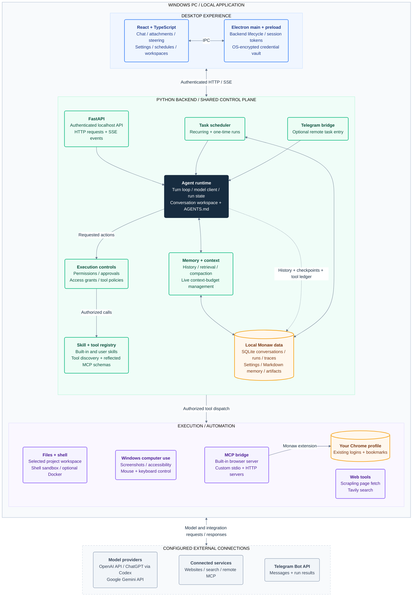

# Monaw Agent

<p align="center">
  
</p>

**An open-source AI desktop assistant for Windows, built with Electron, React, and Python.**

Monaw connects a chat interface to an agent that can work with project files, run commands, automate Chrome and Windows apps, and use MCP tools. It supports OpenAI API keys, ChatGPT account sign-in through the Codex SDK, and Google Gemini API keys.

The application runs on your PC. Chat history, settings, memory, and artifacts are stored locally; model requests go to your selected provider. Windows 10 and 11 are supported; macOS has not been tested.

## Setup and Start

You need **Git**, an internet connection for installation and model access, and Windows 10 or 11. The setup script can install missing **uv** and **Node.js LTS** through Windows Package Manager (`winget`). Supported Node release lines are **20.x starting at 20.19**, **22.x starting at 22.13**, and **24.x**, with npm. Setup and launch check the executable found on PATH against the policy in `frontend/package.json`; other major versions and prereleases are rejected. Python **3.11** is pinned in `backend/.python-version` and installed by uv. Required Windows backend checks use 3.11; a separate runtime compatibility job checks 3.12.

Google Chrome **125+** is needed for browser automation, through the Monaw extension you set up from Settings > Browser. Docker Desktop is optional for isolated shell execution.

### 1. Clone the repository

```powershell
git clone https://github.com/kailiang0120/monaw.git
cd monaw
```

### 2. Run setup.bat

Double-click [setup.bat](setup.bat), or run it from PowerShell in the repository folder:

```powershell
.\setup.bat
```

Setup closes any running Monaw processes from this checkout, installs missing prerequisites, installs the pinned Python runtime, syncs `backend/.venv` from `uv.lock`, and runs `npm ci` in `frontend`. If another application owns a required port, setup stops and identifies it. When setup reports success, you can close its window.

Run setup for the first installation, or again when dependencies change. If `winget` is unavailable, install uv and Node.js manually before retrying.

### 3. Run start.bat

Double-click [start.bat](start.bat), or run:

```powershell
.\start.bat
```

The launcher starts the Vite renderer server and opens Electron. Electron starts the FastAPI backend on `127.0.0.1:8435`; the launcher exits once startup succeeds. Use `start.bat` each time you want to open Monaw.

### 4. Connect a model

Open **Settings > Connections**, choose a connection below, then select the provider, model, and reasoning effort in the chat composer. Normal desktop setup uses the app settings; no `.env` editing is required.

| Connection | How to configure it | Implementation |
| --- | --- | --- |
| **OpenAI API** | Save your OpenAI API key. | OpenAI Python SDK using the Responses API. |
| **ChatGPT account** | Choose **Sign in with ChatGPT** and complete sign-in. | Codex SDK and its local app-server connection. This is separate from API-key access. |
| **Google Gemini API** | Save your Google API key. | Google GenAI Python SDK. |

Optional connections can be configured as needed:

| Service | Used for | Configuration |
| --- | --- | --- |
| **Tavily API** | Web search. | Tavily API key in Settings > Connections. |
| **Telegram Bot API** | Remote task input and results. | Bot token and allowed users/chats in Settings. |
| **MCP servers** | Additional local or remote tools. | Settings > Tools > MCP; supports stdio and Streamable HTTP. |

Choose a permission mode in Settings or the composer: **Default**, **Full Access**, **Auto Review**, or **Custom**. Browser profiles and allowed domains are configured under **Settings > Browser**; sandbox options are configured separately.

## Capabilities

- **Local work:** read and edit files, run shell commands, and control Windows apps and Chrome.
- **Conversation context:** choose a workspace per chat, load its `AGENTS.md` instructions, retain memory, and steer or stop an active task.
- **Automation and integrations:** schedule tasks, connect MCP servers, and optionally send tasks through Telegram.

## Technology Stack

| Layer | Technologies and role |
| --- | --- |
| Desktop | **Electron** hosts the application, manages the backend, and provides a restricted preload/IPC bridge. |
| Interface | **React 18**, **TypeScript**, **Vite**, and **Tailwind CSS** provide chat, settings, workspace selection, and task controls. |
| Backend | **Python 3.11**, **FastAPI**, **Uvicorn**, and **Pydantic** implement the local HTTP API, validation, and streamed events. |
| Agent orchestration | A **custom Python runtime and turn loop** assemble prompts, call models, authorize actions, execute tools, and process observations. Skills and the tool registry expose capabilities to the model. |
| Model clients | **OpenAI Python SDK**, **Codex SDK**, and **Google GenAI SDK** provide the three model connection routes. |
| Browser and desktop automation | The **Monaw Chrome extension** controls the user's Chrome profile; **Scrapling** fetches pages. **pywinauto**, **pywin32**, and **mss** support Windows controls and screenshots. |
| Tool integrations | The **MCP Python SDK** connects built-in and user-configured MCP servers. |
| Storage and credentials | **SQLite** stores conversations, runs, and app state. **Markdown** stores global and workspace memory. Electron **safeStorage** encrypts saved provider keys and the Telegram token using the OS. |
| Dependencies and tests | **uv** manages Python and its lockfile; **npm** manages the frontend. Checks use **pytest**, **Vitest**, Node's test runner, and TypeScript. |

## Architecture

Monaw has an Electron desktop frontend and a local Python backend. Electron manages the backend process, session authentication, and encrypted credentials. The React UI sends HTTP requests to FastAPI and receives progress, tool activity, and responses through Server-Sent Events (SSE).

### System Architecture



Electron handles startup, credentials, and the authentication bridge; the React renderer calls FastAPI directly. Desktop chat, scheduled runs, and Telegram all enter the same agent runtime. Solid arrows show calls or data exchange; dashed arrows show lifecycle and persistence.

### Agent Design

The agent repeats **update context → fit context → call model → authorize → execute → observe**. Observations feed the next iteration. A complete answer exits from the model stage; denied actions return feedback without execution, and pending approvals wait for resolution.

[](docs/assets/monaw-agent-loop.png)

| Alongside the loop | What happens |
| --- | --- |
| **Context and tool discovery** | The runtime combines workspace `AGENTS.md`, skill instructions, history, attachments, and retrieved memory. Tool search can expose deferred schemas for later model calls. |
| **Authorization** | Default, Full Access, Auto Review, and Custom modes determine action handling. Pending approvals or access grants wait for resolution; blocked actions return feedback, and repeated denials can pause the turn. |
| **Execution** | Compatible tool calls can overlap. Workers enforce timeouts, cooperative cancellation, and resource conflict checks. Shell commands use the configured sandbox policy; Chrome automation goes through the Monaw extension on the user's own profile. |
| **User control and recovery** | Steering enters at model or tool boundaries. Stop, exhausted budgets, or failures can end or pause a turn; history, checkpoints, and the tool ledger support recovery. |
| **Persistence and observability** | Conversation history, results, run status, usage, latency, and failure evidence are recorded locally. Progress and tool events stream back to the caller. |

See [docs/development.md](docs/development.md) for the module map and implementation details.

## Workspaces, Memory, and Local Data

Click **Default workspace** above the message box to choose a project folder for a conversation. That folder determines relative file paths, command locations, and project `AGENTS.md` instructions. Change it while the agent is idle, or reset it to the default workspace.

Memory has two scopes: **global** for information about you, and **workspace** for information specific to a folder. Rules and preferences are included in their scope's prompts; relevant facts are retrieved for the current request. Explicit memory tools and background learning save information from your own words. The Memory switch is under **Settings > Identity**. See [the memory guide](docs/memory.md).

By default, Monaw stores its data under `%USERPROFILE%\.monaw`:

```text
.monaw/
  runtime/                 settings, SQLite databases, logs, Electron store
  workspace/               default agent working folder
  browser/                 browser screenshots and artifacts
  memory/
    global.md              global rules, preferences, and facts
    workspaces/*.md        memory for each project folder
```

Your Chrome profile remains in Chrome's own folder. Override the main data folder with `MONAW_HOME` or `AGENT_HOME`; use `AGENT_RUNTIME_DIR`, `AGENT_WORKSPACE_DIR`, or `AGENT_MEMORY_DIR` to override individual locations.

The backend is a privileged local API: `/api` requests require an Electron-issued session, and the server binds to loopback by default. Keep it local. Saved API keys are encrypted in Electron main and cannot be read back by renderer JavaScript. See [operations](docs/operations.md) for security, backup, and retention details.

## Development

For manual setup, install uv and a supported Node.js version, then run from the repository root:

```powershell
cd backend
uv sync --locked
cd ..\frontend
npm ci
cd ..
.\start.bat
```

Run backend and frontend checks together:

```powershell
.\scripts\verify.ps1
```

Use `npm run dev` inside `frontend` to run Vite and Electron directly. Electron still starts the backend. Backend-only development, authentication, the module map, and packaging notes are in [the development guide](docs/development.md).

## Troubleshooting

| Problem | What to check |
| --- | --- |
| Setup fails | `%USERPROFILE%\.monaw\runtime\setup\setup.log`; confirm Git and winget are available, or install uv and Node.js manually. |
| App does not open | Run `setup.bat` again, then check `runtime\launcher\vite.log` and `runtime\launcher\electron.log` under the Monaw data folder. |
| Backend cannot start | Check `runtime\backend.log`; run `uv sync --locked` inside `backend`. |
| Node engine or frontend dependency errors | Upgrade to a supported Node.js version, then run `npm ci` inside `frontend`. |
| A port is occupied | Check Vite port `5275` and backend port `8435`; the launcher reports conflicts. |
| Browser automation cannot connect | Check the Monaw extension status in Settings > Browser and that the extension is on at `chrome://extensions`, then see the [browser automation guide](docs/browser-automation.md). |

For a custom uv installation, set `AGENT_UV_PATH` to the full path of `uv.exe` before starting Monaw.

## Documentation

| Topic | Guide |
| --- | --- |
| Architecture, modules, and testing | [Development](docs/development.md) |
| Browser and Windows automation | [Browser automation](docs/browser-automation.md) / [Computer use](docs/computer-use.md) |
| Memory and workspaces | [Memory](docs/memory.md) |
| Tool integrations and remote tasks | [MCP](docs/mcp.md) / [Telegram](docs/telegram.md) / [Scheduling](docs/scheduling.md) |
| Action approval and execution isolation | [Permissions](docs/permissions.md) / [Sandboxing](docs/sandboxing.md) |
| Runtime operations and HTTP endpoints | [Operations](docs/operations.md) / [API reference](docs/api.md) |
| Planned work | [Roadmap](docs/roadmap.md) |

This repository is intended for cloning, local use, and code review. External contributions are not being accepted yet.

## License

Apache License 2.0. See [LICENSE](LICENSE).
