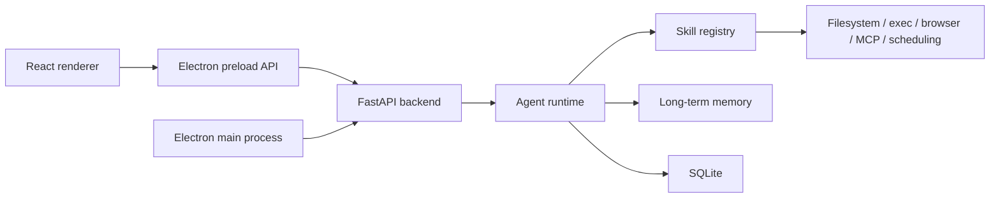

# Monaw Development

This document is for contributors and maintainers. The root README is for end users.

For first-time setup, use [Windows source setup and startup](source-setup.md). It explains `setup.bat` and `start.bat`, prerequisite versions, live setup output, manual installation, data locations, environment overrides, and troubleshooting. The commands here assume that setup has already completed.

## Tech Stack

- Frontend: Electron, React, Vite, TypeScript, Tailwind CSS.
- Backend: FastAPI, Uvicorn, Pydantic.
- Python environment and dependencies: `uv`, `pyproject.toml`, and `uv.lock`.
- LLM providers: OpenAI SDK with an API key or a Sign in with ChatGPT token (`app/agent/chatgpt_account.py`), and Google GenAI SDK.
- Storage: SQLite plus local markdown memory files.
- Automation: the Monaw Chrome extension (`browser-extension/`, a Manifest V3 extension using `chrome.debugger`) with its local server in `backend/app/skills/browser_use/extension/`, Scrapling for `browser_fetch`, MCP, and Windows desktop automation packages.

## Development Commands

Node 22.13.0 is the development and frontend CI baseline. The package engine
range still accepts Node 20.19+, 22.13+, and 24.x, but the 20.x and 24.x lines
are not matrix-tested on every pull request.

Run the full dev app from the frontend folder:

```powershell
cd frontend
npm run dev
```

This starts Vite and Electron. Electron starts the backend.

Unlike `start.bat`, this command keeps Vite/Electron output attached to the terminal and does not run the launcher's prerequisite or readiness checks. The desktop backend is managed by Electron, runs with `uv run --locked --no-dev`, and does not auto-reload Python edits. Restart Electron after changing backend or Electron code. Vite normally reloads renderer edits automatically.

Run only Vite:

```powershell
cd frontend
npm run dev:vite
```

Run only Electron:

```powershell
cd frontend
npm run dev:electron
```

Have Vite running on port `5275` first. Electron's renderer URL, navigation policy, and development CORS settings use that port. For a local bundled-renderer check instead, run `npm run build:renderer`, set `$env:MONAW_RENDERER_MODE = 'bundle'`, then start Electron. Remove that environment variable to return to Vite development. The source backend still needs uv and its Python environment in either renderer mode.

Run only the backend:

```powershell
cd backend
$env:MONAW_CONTROL_SECRET = 'replace-with-at-least-32-random-characters'
uv run --locked uvicorn app.main:app --host 127.0.0.1 --port 8435 --reload
```

This is a separate backend-only development process. Do not also start the Electron-managed backend on the same port. Replace the example secret before using it. `--reload` in this manual command enables Python reload; it is intentionally absent from the normal desktop launcher.

Health check:

```powershell
Invoke-WebRequest -UseBasicParsing http://127.0.0.1:8435/health
```

All `/api` endpoints require a short-lived bearer session issued by Electron.
The `/health` endpoint is the only unauthenticated runtime endpoint. Browser-only
development must explicitly opt into a development token:

```powershell
$env:MONAW_CONTROL_SECRET = 'replace-with-at-least-32-random-characters'
$env:MONAW_ALLOW_DEVELOPMENT_TOKEN = '1'
$env:VITE_MONAW_CONTROL_TOKEN = $env:MONAW_CONTROL_SECRET
$env:CORS_ALLOW_ORIGINS = 'http://localhost:5275,http://127.0.0.1:5275'
```

Set these variables before starting both the standalone backend and Vite. Then open `http://localhost:5275` in a browser. Run them in the same terminal environment or provide the same values in both terminals; setting them after either process starts does not change that running process. Remove the development-token variables after testing. A normal desktop launch generates its own secret and disables this browser-development bypass.

Do not expose the backend through port forwarding, a reverse proxy, a tunnel, or
a non-loopback bind. Electron rejects non-loopback backend hosts unless
`MONAW_ALLOW_UNSAFE_BACKEND_HOST=1` is deliberately set.

Operational security, incident response, backup, restore, retention, and
complete-data-deletion guidance lives in [operations.md](operations.md). The
generated route table lives in [api.md](api.md) and is checked by tests.

## Credential Storage

Provider API keys and the Telegram bot token are encrypted in Electron main
using the operating system's credential encryption through `safeStorage`.
Renderer JavaScript can set, delete, apply, and read boolean status for a
credential, but it cannot retrieve a stored plaintext value.

On first launch after upgrading, Electron migrates legacy plaintext values from
the existing Electron store. It encrypts and verifies each value before removing
the legacy plaintext. If OS encryption is unavailable or verification fails,
credential operations fail and the original value is retained.

Browser-only development does not have OS-backed Electron storage. Credentials
entered in that mode are sent directly to the authenticated backend for the
current process and should be treated as development-only configuration.

Frontend npm commands must run from `frontend`, not the repo root.

Backend dependency commands must run from `backend`. Use `uv add <package>` to
add a runtime dependency, `uv add --dev <package>` to add a development
dependency, and commit both `pyproject.toml` and `uv.lock`. Use
`uv sync --locked` when reproducing a committed environment.

## Related Module Docs

- [Memory](memory.md)
- [MCP](mcp.md)
- [Browser automation](browser-automation.md)
- [Scheduling](scheduling.md)
- [Telegram](telegram.md)
- [Permissions](permissions.md)
- [Sandboxing](sandboxing.md)
- [Operations](operations.md)
- [Windows packaging](packaging.md)
- [API route reference](api.md)
- [Composio: automated setup, reviewed actions, and upstream attribution](composio.md)

## Runtime Layout

Runtime data is stored under:

```text
%USERPROFILE%\.monaw\runtime\
```

Important files:

```text
%USERPROFILE%\.monaw\runtime\agent.db          SQLite conversations, runs, and app state
%USERPROFILE%\.monaw\runtime\settings.json     Runtime settings saved by the app
%USERPROFILE%\.monaw\runtime\backend.log       Backend process log
%USERPROFILE%\.monaw\runtime\launcher\         Launcher logs
```

The user's Monaw home folder is:

```text
%USERPROFILE%\.monaw\
```

Runtime layout:

```text
%USERPROFILE%\.monaw\runtime\        settings.json, agent.db, backend.log, Electron store
Documents\monaw\YYYY-MM-DD\         daily default working folder for chat tools
%USERPROFILE%\.monaw\browser\        browser artifacts
%USERPROFILE%\.monaw\memory\         global and workspace memory markdown files
%USERPROFILE%\.monaw\skills\         skills created or imported by the user
```

Override the main folder with `MONAW_HOME` or `AGENT_HOME`, runtime with `AGENT_RUNTIME_DIR`, workspace with `AGENT_WORKSPACE_DIR`, and memory with `AGENT_MEMORY_DIR`.

The default workspace root uses the system Documents folder, including Windows folder redirection (such as OneDrive). The root is created on launch; each new chat gets its dated folder before its first task. `MONAW_HOME` and `AGENT_HOME` relocate application data; use `AGENT_WORKSPACE_DIR` to override the workspace root. Existing chats retain their saved paths. `AGENT_RUNTIME_DIR` alone does not move Electron's store or its backend output log; see the [override table](source-setup.md#paths-and-environment-overrides).

## Architecture



## Module Guide

```text
backend/app/main.py                    FastAPI app, CORS, health check, scheduler and Telegram startup
backend/app/config.py                  Environment-backed defaults used before runtime settings load
backend/app/api/routes/                HTTP API routes for chat, settings, memory, files, uploads, sandbox, diagnostics, approvals, access grants, conversations, and scheduled tasks
backend/app/agent/runtime.py           Runtime assembly for settings, LLM client, memory, tools, MCP, and run execution
backend/app/agent/turn_loop.py         Main agent turn loop and tool-call flow
backend/app/agent/llm_client.py        OpenAI and Gemini client abstraction
backend/app/agent/settings_store.py    Local runtime settings persistence
backend/app/agent/memory_store.py      Global and workspace markdown memory, retrieval, and learning
backend/app/agent/scheduler.py         Scheduled task service and run orchestration
backend/app/agent/sandbox/             Exec sandbox policy, backend selection, sessions, and path controls
backend/app/agent/harness/             Tool protocol, execution wrapper, and policy checks
backend/app/agent/observability/       Trajectory logging
backend/app/agent/security/            Prompt-injection detection helpers
backend/app/skills/                    Runtime skills exposed to the agent
backend/app/integrations/telegram/     Optional Telegram bridge
frontend/electron/                     Electron main and preload processes
frontend/src/                          React renderer, settings UI, chat UI, scheduling UI, API clients, and tests
scripts/start-windows.ps1              Windows dev launcher used by start.bat
docs/browser-automation.md             Browser automation behavior and troubleshooting
docs/mcp.md                            MCP server setup, lifecycle, and reflected tools
docs/memory.md                         Global and workspace memory, storage, and APIs
docs/permissions.md                    Permissions, approvals, and access grants
docs/sandboxing.md                     Sandbox behavior and troubleshooting
docs/scheduling.md                     Scheduled task lifecycle and APIs
docs/telegram.md                       Telegram bridge setup and operations
```

Current built-in skills:

```text
browser_use       Browser automation (Monaw extension server + browser_fetch)
computer_use      Windows desktop observation and control helpers
core              Core utilities (internal)
exec              Command execution (internal)
filesystem        File management (internal)
mcp_bridge        MCP integrations (internal)
memory            Global and workspace memory tools (internal)
scheduling        Scheduled task tools
skill_creator     Skill creation and reload tools
web_search        Web search (when Tavily or, without Tavily, Keenable is configured)
```

Skills created with the skill creator or imported through **Settings > Tools > Skills > Import** are stored in `~/.monaw/skills` (the `skills` folder of Monaw home), loaded after the built-in skills, and cannot take a built-in skill's name. General agent filesystem tools cannot modify either skill folder. The approved skill creator and authenticated Settings import routes provide the supported write paths. Imported skills remain instruction-only and do not load bundled `tools.py`; see [skills and plugin compatibility](skills.md).

Each `SKILL.md` must begin with a closed YAML frontmatter block. It is the source of truth for a skill's trigger description, `display_name`,
one-line `summary`, tier, default, and prompt guidance. Internal skills use
`tier: internal` and `always: true`; they stay registered for the runtime but are omitted
from the Settings capability toggles. Optional and recommended skills are the user-facing
catalog.

## Models

The model dropdown uses:

```text
GET /api/settings/model-options
```

Connection definitions and model metadata live in
`backend/app/agent/model_registry.py`. `model_catalog.py` combines that registry
with custom model names, account discovery and credential readiness. The API
returns stable connection IDs, display labels, protocol names, readiness reasons
and supported reasoning efforts. Readiness means credentials are configured; it
does not promise that a remote service is reachable or that a subscription can
use every model.

The current connections are `openai` (OpenAI API), `codex` (ChatGPT account) and
`gemini` (Google). These IDs retain the existing persisted `provider` and
scheduled `model_provider` values, so existing settings and pinned occurrences
do not need a database rewrite. Valid saved model IDs remain intact when absent
from the current catalog. Explicit legacy aliases still migrate within their
connection. An unavailable selection is displayed instead of silently replaced.

Chat, Settings and scheduled tasks use `frontend/src/components/ModelPicker.tsx`
with the global `Dropdown`, a shared catalog cache and selection helpers. All use the display format
`Model name · Connection name`; protocol and credential details remain in
connection settings. An explicitly empty reasoning list hides the reasoning
control. Unknown models do not acquire guessed reasoning capabilities from
their brand or name.

The chat picker becomes a brain icon when its composer is at most 720px wide.
Its menu and tooltip retain the full model and connection names.

The catalog includes GPT-6.2 Sol, GPT-6.2 Astra, GPT-6.1 Terra and the Gemini 4
Neon, Hydrogen, Carbon and Argon models. Existing default selections remain
unchanged. Model IDs and reasoning levels follow the
[OpenAI model catalog](https://developers.openai.com/api/docs/models) and
[Google's Gemini model documentation](https://aistudio.google.com/docs/latest-model).
Gemini 4 uses `google-genai` 2.34.0 and preserves thought signatures across turns.
Migration 0029 adds private provider-history columns to live and archived
messages. Complete Gemini turn journals are committed atomically and replayed
only for the same provider/model. Existing rows retain their text fallback;
uploaded images still require attachment validation when restored. The private
wire history is excluded from conversation API responses. Incomplete journals
and tool payloads that require secret redaction use sanitized text history
instead of persisting raw provider data.

To add a future provider, register its connection metadata and execution adapter,
then verify discovery, streaming, cancellation, tool calls and usage accounting.
The picker consumes the catalog without its own provider-specific model lists.
This change supports the three existing cloud/account connections only; local
servers and configurable custom endpoints are not enabled.

Default backend settings:

```text
provider: openai
model: gpt-6-luna
reasoning_effort: medium
```

Images and screenshots are sent to the configured chat model, which reads them
natively. There is no separate vision model.

ChatGPT account discovery replaces the curated fallback with the models and
reasoning levels reported for the signed-in account.

## Harness continuity and recovery

Each turn owns its tool repetition policy and cancellation scope. Cached runtimes
have their own memory manager and model client; conversation history remains in
the shared SQLite database.

Before each model call, the harness estimates the live messages, current system
prompt, and visible tool schemas, with space reserved for the reply. When needed,
it shortens large tool observations and summarizes older completed rounds through
bounded summarization requests. User instructions, attachment references, and the
latest tool-call round are preserved. Full tool results remain in history. A
request that still exceeds the budget pauses without sending it to the provider.

User uploads and steering attachments persist as scoped handles. Follow-up turns
restore accessible images after checking the attachment scope, expiry, and read
policy. Older messages containing upload handles can also restore their images.

Stop and tool timeouts signal cooperative cancellation and allow a short drain
period. Workers that remain active are tracked until they actually finish; further
actions in that conversation or on conflicting resources are blocked across cached
runtimes. Python threads cannot be forcibly killed, so an interrupted action may
still finish and must be verified before retrying.

Unexpected harness failures checkpoint the user request, accepted steering,
partial response, and tool ledger. A subsequent turn restores bounded evidence
from the interrupted task, including its tool inputs and result status.

## Memory Internals

`backend/app/agent/memory_store.py` keeps memory in two scopes, each one markdown file: `global.md` for the user, and `workspaces/<folder>-<hash>.md` per working folder. Entries are bullets under `## Rules`, `## Preferences`, and `## Facts`. Rules and preferences are pinned into every prompt of their scope; facts are ranked against the turn's message. Writes come only from the user's words, through the `memory_*` tools or the background learner. See [memory.md](memory.md).

## Browser Automation

Browser settings and status live in Settings -> Browser. Monaw drives the user's own Chrome through the Monaw Chrome extension (`browser-extension/`). The built-in browser server (`backend/app/skills/mcp_bridge/builtin.py`) runs `backend/app/skills/browser_use/extension/` as a stdio MCP server that the extension connects to over a loopback WebSocket; `install.py` copies and pairs the extension, and `toolset.py`, `snapshot.py`, and `session.py` implement the tools over DevTools commands the extension relays. `chrome_launch.py` finds Chrome and opens it normally when the extension is not connected; `url_policy.py` holds the URL allow-list and SSRF checks shared by browser navigation and `browser_fetch` (`tools.py`). Chrome 125 or later is required. See [browser-automation.md](browser-automation.md).

## MCP

MCP servers are configured in Settings -> Tools -> MCP. The app supports custom stdio and streamable HTTP server entries. The browser server ships built into the browser automation skill (`backend/app/skills/mcp_bridge/builtin.py`) and is not configured here.

Diagnostics in the same panel show server connection state, reflected tools, process state, and startup errors.

Custom credentials use a server/transport/field-scoped encrypted vault with an authenticated main-process handoff. See [MCP credential migration and headless development](mcp-credentials.md). Tests cover interrupted migration and use a real local MCP fixture plus Windows OS encryption in the application suite.

## Sandbox And Permissions

Approvals and access grants run before tool execution. Shell execution then routes through the sandbox layer.

Sandbox modes include:

```text
off (shell disabled)
auto (strong isolation or explicit host approval)
enforce (strong isolation required)
host (unsandboxed, approval required)
docker
local_restricted (advisory host runner, approval required)
```

See `docs\sandboxing.md` for backend behavior and limitations.

## Testing

Electron's source launch uses `--no-dev`, which can remove pytest and other development-only packages from the shared backend environment. Run `uv sync --locked` in `backend` before invoking development tools directly. The repository's backend test script prepares its required test environment.

Run the complete local verification workflow from the repository root:

```powershell
.\scripts\verify.ps1
```

Backend tests are divided into independent groups:

```powershell
.\scripts\test-backend.ps1 -Group api
.\scripts\test-backend.ps1 -Group runtime
.\scripts\test-backend.ps1 -Group policy
.\scripts\test-backend.ps1 -Group sandbox
.\scripts\test-backend.ps1 -Group skills
.\scripts\test-backend.ps1 -Group memory
.\scripts\test-backend.ps1 -Group integrations
```

Use `-Group all` to run the complete backend suite. Each individual test has a
120-second timeout, and the wrapper applies a 15-minute timeout to the suite.
New backend test files must be assigned to exactly one group in
`backend/conftest.py`.

Frontend verification:

```powershell
cd frontend
npm run verify
```

This runs Vitest, TypeScript type checking, and the renderer production build.

For the CI command including a JUnit renderer report, run `npm run verify:ci`.
For Electron plus the real backend, run `npm run test:app` on Windows. See
[disposable application verification](application-testing.md) for fixtures,
workflow assertions, artifacts and the remaining installed-app checks.
Backend reports can be requested with, for example,
`./scripts/test-backend.ps1 -Group sandbox -JUnitPath test-results/sandbox.xml`.
Report paths are relative to `backend`; generated `test-results/` directories are ignored by Git.

Capture repeatable test and bundle baselines:

```powershell
.\scripts\measure-baseline.ps1
```

Baseline JSON is written under `.artifacts/baselines/` and is intentionally not
committed because timings and paths are machine-specific. Startup time, idle API
request rate, and representative database growth remain explicit manual fields
until provider-independent application harnesses are available.

## Per-commit integrity

The test suites prove that the tip of a branch works. They cannot prove that
each commit leading to it works: a commit that imports a module which only
lands in a later commit merges cleanly and still passes at the tip, but it
breaks `git bisect`, a partial revert, and anyone who checks it out.

```powershell
.\scripts\check-commits.ps1
.\scripts\check-commits.ps1 -Base main -Head HEAD
.\scripts\check-commits.ps1 -SkipFrontend
```

With no arguments the range is whatever the current branch adds on top of
`origin/main`. Each commit is checked out into a scratch worktree — never your
working tree, so uncommitted work is safe — and must pass five checks:

- every module under `backend/app` compiles,
- every module imports,
- the FastAPI app boots and serves `/health`,
- the frontend type-checks,
- the renderer bundle builds.

That is roughly 30 seconds per commit. The test suites are deliberately not run
per commit; that is the tip's job and would cost hours.

The backend half runs standalone against any tree:

```powershell
python scripts\check-imports.py --tree .
```

Failures are grouped by error text, so the root cause is the first thing
printed rather than the dozens of submodules that inherit it.

## Continuous integration

`.github/workflows/verify.yml` runs on pull requests and pushes to `main`.
Feature branches use the pull-request run without a duplicate push run:

- **Backend (Python 3.11)** — each test group as a separate Windows job, including
  persisted scheduling/reconciliation, scoped API mutations, approval replay,
  effective shell-environment disclosure and browser navigation-target checks.
  The API job also checks generated API documentation for drift. Every group in
  `conftest.py` must also appear in the workflow matrix and in `pytest.ini`;
  `test_every_backend_test_group_runs_in_ci` fails if the three lists drift,
  because a group missing from the matrix would pass locally and never run.
- **Python 3.12 compatibility** — Windows `runtime`, `integrations`, `sandbox`,
  and `skills` groups, covering scheduling, tool completion/cancellation, approval
  replay, browser/fetch policy and shell backends on the additional interpreter.
- **Docker sandbox (Linux)** — the Windows jobs mock Docker, so this is the
  only job that proves the pinned digest resolves, that a container actually
  runs, and that the offline module table in `policy.py` is a subset of what
  the image can really import. Tests are selected by path because collecting
  the whole suite would import the Windows-only `computer_use` modules.
  `MONAW_REQUIRE_DOCKER_TESTS=1` makes unavailable Docker prerequisites a failure.
  The job also runs workspace path-policy tests and real-container copy-back
  checks for successful and failed commands. Windows sandbox tests cover junctions,
  hard links, host-edit conflicts, and session expiry without polling.
- **Per-commit integrity** — the checks above, capped at 20 commits.
- **Frontend** — `npm run verify:ci` (Vitest, Electron tests, type-check, build),
  once on Node 22.13.0, matching the application job and packaging baseline.
  The check remains named `Frontend (Node 22.13.0)`.
- **Electron and backend workflows (Windows)** — `npm run test:app` on Python
  3.11 / Node 22.13, covering authenticated startup, streaming/persistence,
  approval and rejection, parallel stop, scheduling, uncertain run reconciliation
  backend interruption, and MCP migration/rotation/restart/schema/revocation, with disposable application data and controlled providers. The credential workflow requires real OS encryption and a real local MCP transport; it does not silently skip those checks.

Backend, compatibility, real-Docker, and renderer jobs upload JUnit reports even
after test failure when reports were produced. Artifacts have distinct names per
matrix entry. New pushes cancel obsolete runs of the same workflow/ref. These
jobs do not yet prove a packaged/installed Electron workflow, installer, or upgrade.

When changing migrations, update the fresh-database regression's expected schema
versions and verify the new tables. Approval integration tests must explicitly
bind the production replay adapter they exercise: registry tests and dynamic
skill loading can otherwise leave a different adapter in the same process.
Application tests that inspect persisted history must wait for the turn to finish;
visible streamed answer text does not mean the atomic history commit has completed.
Skill-import workflows enter Settings → Tools → Skills before opening Import.
Restart workflows retain the Electron child-process handle and verify its clean
exit plus backend-port closure; a disposed inspector channel is not a reliable
source for checking whether the OS process is still running.

## Connector development

The provider-neutral connector foundation lives in `backend/app/connectors`. Read the [connector architecture and adapter guide](connectors.md) before adding a service. [GitHub](github-connector.md) uses native device sign-in; the categorized daily-app connectors use a user-owned [Composio Platform project](composio.md) behind the same permissions and account contracts. Manage accounts through `/connector` or Settings → Tools → Connectors.

For connector changes, run the core connector tests and renderer verification. `uv sync --locked` installs the pinned Composio API client; no companion build or separate runtime is needed. The user saves a Platform project key in Monaw desktop, then Monaw creates the managed OAuth configuration and hosted sign-in link. See the [setup guide](composio.md) for permissions, usage, and live-account verification. Do not expand the upstream catalog or OAuth scopes without reviewing the corresponding Monaw schemas and permissions.
