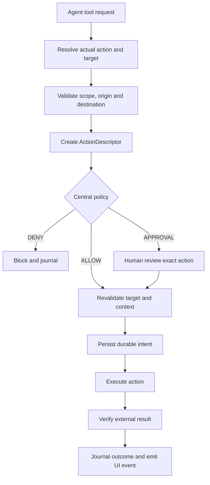
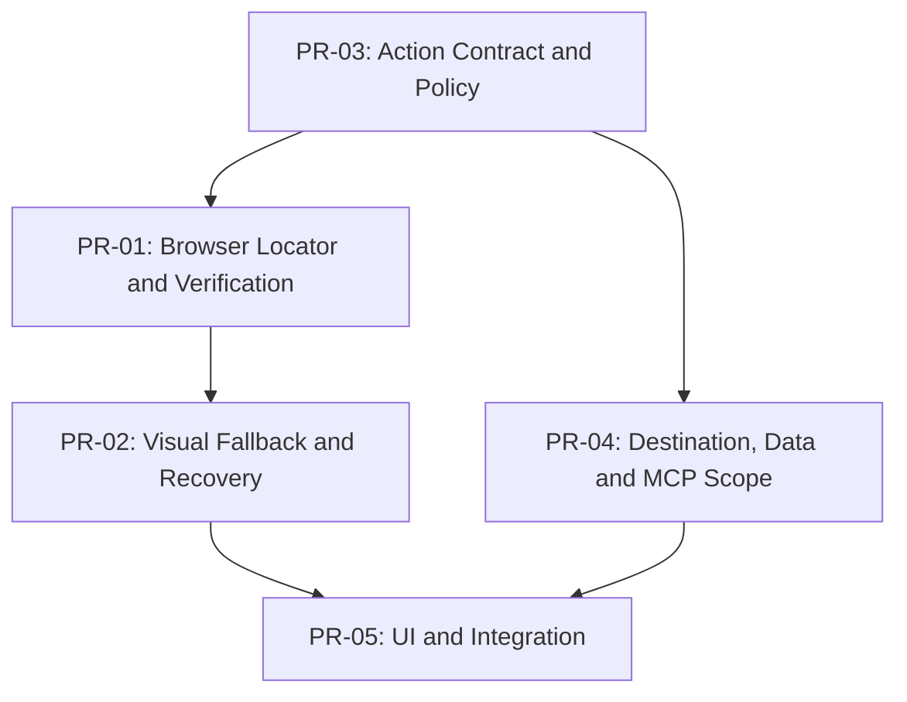

# Monaw v1.2 — Browser Reliability & Action-Level Security

> **Status:** Proposed execution plan\
> **Baseline reviewed:** `main` at `8d5f9d94f2b5ea22063fa49f56a77feb09f60cca` (2026-11-04 review)\
> **Assumption:** The six v1.1 PRs covering Durable Journal, Crash Recovery, File Preview/Undo, and Execution UI are already implemented in the user's working codebase. The public `main` inspected at review time did not yet show all of those components, so integration names below are proposals to map onto the completed implementation.\
> **Scope:** Browser automation reliability, action-level authorization, destination/data-scope controls, MCP and cross-tool enforcement, security UX, and integration tests.\
> **Out of scope:** Rebuilding v1.1 systems, generic agent benchmarking, new operating systems, and unrestricted browser/network sandbox promises.

## 1. Goals and Definition of Success

### A. Browser automation reliability

- Prefer Accessibility Tree / DOM element targeting; use visual targeting only as a controlled fallback.
- Validate target identity and page freshness *before* acting.
- Verify meaningful *post-action effects* rather than equating successful CDP input dispatch with task success.
- Report separate states for `executed`, `verified`, `failed`, and `uncertain` effects.
- Never blindly retry a potentially consequential submission after a timeout, disconnect, or crash.

### B. Action-level security

- Evaluate the actual action, destination, data scope, and execution context, rather than tool name alone.
- Bind human approvals to a canonical action, current target, exact material parameters, run/operation identity, and expiry.
- Cover generic browser actions (`click`, `press_key`, `evaluate_script`), desktop actions, upload, networking, and MCP entry points as far as the adapter can enforce them.
- Fail closed when critical context is unknown; never treat tool descriptions or model text as proof of authorization.
- Redact secrets from approval previews, durable events, logs, and support reports.

## 2. Existing Architecture to Reuse

Monaw already exposes Chrome via its extension and DevTools relay:

| Existing component | Current role | v1.2 addition |
|---|---|---|
| `backend/app/skills/browser_use/extension/snapshot.py` | Main-frame Accessibility Tree snapshot with UIDs | Structured target identity and freshness metadata |
| `backend/app/skills/browser_use/extension/session.py` | Tab/CDP session, page lifecycle, navigation, dialogs | Document/frame revision, recovery evidence |
| `backend/app/skills/browser_use/extension/toolset.py` | CDP-backed clicks, fills, uploads, scripts | Verification, controlled fallback, action-scoped policy |
| `backend/app/skills/browser_use/extension/tools_schema.py` | Model-exposed browser tool schemas | Optional verification expectations / structured results |
| `backend/app/skills/browser_use/url_policy.py` | Explicit URL and allowed-domain checks | Enforce actual origin, redirects and destination boundaries where observable |
| `backend/app/agent/execution_gate.py` | Approval resolution and execution resume | Exact action/child-dispatch binding |
| `backend/app/agent/approval_broker.py` | Durable approval tickets | Bind tickets to action identity and scoped parameters |
| `backend/app/skills/mcp_bridge/registry.py` | MCP tool reflection, schema hash, approval | Runtime data scope and destination policy |
| v1.1 Durable Journal and Execution UI | Persistent operations, uncertainty, recovery, audit UI | Reuse for browser/MCP effects and approvals |

**Design constraint:** Do not duplicate Journal, approval, or event persistence. Connect browser and action-security modules to the already-implemented v1.1 interfaces.

## 3. Shared Action Contract

Both workstreams should use one normalized `ActionDescriptor`, built from **validated runtime facts** rather than model-supplied labels.

### Proposed backend layout

```text
backend/app/agent/action_security/
  __init__.py
  models.py
  classifier.py
  policy_engine.py
  data_scope.py
  destination_policy.py
  sensitive_data.py
  approval_binding.py
  audit.py

backend/app/skills/browser_use/extension/
  locator.py
  page_state.py
  action_verifier.py
  action_executor.py
  visual_target.py
  visual_fallback.py
  browser_recovery.py
```

### `ActionDescriptor` fields

| Field | Meaning |
|---|---|
| `action_id` | Unique normalized action identifier |
| `run_id`, `operation_id` | Correlation to v1.1 Durable Journal |
| `tool_name` | Original registered tool and true inner action |
| `action_kind` | `read`, `navigate`, `type`, `click`, `submit`, `upload`, `delete`, `execute_code`, `network_send`, etc. |
| `target` | Verified page origin, app, file path, or MCP server |
| `destination` | Concrete endpoint, origin, recipient or target path, if known |
| `data_scope` | Permitted files, fields, content categories and byte estimates |
| `side_effect` | `none`, `local_mutation`, `external_mutation`, `irreversible`, `unknown` |
| `interactive` / `execution_source` | Desktop, scheduled, Telegram or other origin |
| `expected_effect` | Observable condition establishing success |
| `risk_level` | Derived risk level, not blindly accepted from model/third-party metadata |
| `context_version` | Document/frame/page revision used during approval |
| `authorization_binding` | Digest over the canonical, material action parameters |

### Action pipeline



**Critical security distinction:** The descriptor describes an operation; it does not grant permission. Authorization always originates from trusted backend policy and the current validated runtime context.

---

## 4. PR-01 — Browser Element Resolution + Action Verification

**Priority:** P0\
**Goal:** Make UID-based browser interactions target-aware, state-aware and verifiable.

### Modify

```text
backend/app/skills/browser_use/extension/snapshot.py
backend/app/skills/browser_use/extension/session.py
backend/app/skills/browser_use/extension/toolset.py
backend/app/skills/browser_use/extension/tools_schema.py
backend/app/agent/tests/test_browser_extension_tools.py
backend/app/agent/tests/test_browser_extension_bridge.py
```

### Add

```text
backend/app/skills/browser_use/extension/locator.py
backend/app/skills/browser_use/extension/page_state.py
backend/app/skills/browser_use/extension/action_verifier.py
backend/app/skills/browser_use/extension/action_executor.py
backend/app/agent/tests/test_browser_locator.py
backend/app/agent/tests/test_browser_action_verification.py
```

### Implementation

1. **Structured locators:** Associate snapshot UID with accessible role/name, backend DOM node ID, frame and document identity, visibility, enabled status, bounding rectangle, optional stable attributes and snapshot revision.
2. **Pre-action revalidation:** Check tab/document identity, re-resolve the node, confirm the element remains attached, visible and interactive, and hit-test where supported.
3. **Stale targets:** Allow a bounded refresh and re-resolution only when identity is unambiguous. Do not silently choose a similar-looking replacement.
4. **Post-action verifier:** Allow a structured `expected_effect`, e.g. URL changed, element appeared/disappeared, value became expected value, dialog opened, file download began, or explicit application success state appeared.
5. **Separate dispatch from verification:** Distinguish successful CDP input dispatch from verified completion of the user's requested operation.
6. **Action-specific retries:** Permit safe repeat of read-only observations, conditional retry of verified idempotent field updates, and prohibit blind retry of uncertain submissions/payments/messages/uploads.
7. **Frame coverage:** Support accessible frames with origin checks; return explicit unsupported/inaccessible outcomes when CDP permissions or page restrictions prevent reliable inspection.

### Example structured outcome

```json
{
  "status": "verified",
  "action_id": "action_123",
  "action_executed": true,
  "verification": {"type": "url_changed", "passed": true}
}
```

### Tests

- DOM re-render after snapshot; target replaced with a different element.
- Duplicate accessible names and ambiguous targets.
- Hidden or obstructed target, moving element, stale frame/document.
- SPA navigation without full page reload.
- Browser dialog during click/fill.
- Command succeeds but expected business state does not change.
- Click succeeds and response is lost.
- Iframe access permitted, denied or unavailable.

### Acceptance criteria

- Supported state-changing browser actions report execution and verification independently.
- No stale resolution silently acts on an unrelated target.
- Unverified side effects cannot be presented as confirmed success.
- Existing exposed browser tools retain backward compatibility.
- All browser-extension regression tests pass.

---

## 5. PR-02 — Visual Fallback + Browser Recovery

**Priority:** P1\
**Goal:** Recover gracefully when structured element access fails, without opening a security bypass.

### Modify

```text
backend/app/skills/browser_use/extension/toolset.py
backend/app/skills/browser_use/extension/session.py
backend/app/skills/browser_use/extension/snapshot.py
backend/app/skills/browser_use/extension/bridge.py
browser-extension/service_worker.js
```

### Add

```text
backend/app/skills/browser_use/extension/visual_fallback.py
backend/app/skills/browser_use/extension/visual_target.py
backend/app/skills/browser_use/extension/browser_recovery.py
backend/app/agent/tests/test_browser_visual_fallback.py
backend/app/agent/tests/test_browser_recovery.py
```

### Controlled fallback sequence

```text
Accessibility/DOM locator
    -> fresh snapshot + re-resolution
    -> screenshot + visual target proposal
    -> validate screenshot/document/viewport freshness
    -> hit-test target where possible
    -> same action-level authorization gate
    -> execute once
    -> verify effect
```

### Implementation

- Bind screenshot proposal to screenshot dimensions, viewport size, device scale, page ID and document revision.
- Reject stale screenshot/coordinates after scroll, resize, navigation or content replacement.
- Require a current visible target; avoid unvalidated off-screen coordinates.
- Require explicit review or stop for consequential actions when only coordinate evidence is available.
- Record structured recovery reason codes, including:
  - `stale_element`
  - `target_ambiguous`
  - `target_obscured`
  - `navigation_timeout`
  - `page_disconnected`
  - `extension_disconnected`
  - `verification_failed`
  - `action_effect_uncertain`
  - `unsafe_visual_fallback`
- Reuse v1.1 Journal to preserve dispatch status and any proof of result after disconnect/crash.
- Cap retries and force escalation rather than allowing repeated blind clicks.
- Record safe diagnostics: locator method, snapshot revision, verification status, fallback reason, retry count and duration; avoid raw secrets.

### Tests

Extension disconnect/reconnect during a command, page closing, stale screenshot, viewport/DPI change, inaccessible frame, visually similar targets, uncertain submission, fallback after policy denial, retry exhaustion.

### Acceptance criteria

- Visual fallback follows the exact same action-security policy as DOM actions.
- Uncertain external effects are not automatically replayed.
- Every fallback attempt has a bounded retry policy and observable reason.
- Recovery preserves previously confirmed effects and informs the user when verification is impossible.

---

## 6. PR-03 — Central Action Policy + Exact Approval Binding

**Priority:** P0; **merge first**\
**Goal:** Centralize sensitive-operation authorization at trusted adapter/side-effect boundaries.

### Modify

```text
backend/app/agent/execution_gate.py
backend/app/agent/approval_broker.py
backend/app/agent/approval_review.py
backend/app/agent/harness/tool_policy.py
backend/app/agent/harness/tool_runner.py
backend/app/skills/mcp_bridge/registry.py
backend/app/skills/browser_use/extension/toolset.py
```

### Add

```text
backend/app/agent/action_security/models.py
backend/app/agent/action_security/classifier.py
backend/app/agent/action_security/policy_engine.py
backend/app/agent/action_security/approval_binding.py
backend/app/agent/action_security/audit.py
backend/app/agent/tests/test_action_policy.py
backend/app/agent/tests/test_action_approval_binding.py
```

### Implementation

1. **Policy outcomes:** `ALLOW`, `DENY`, `REQUIRE_HUMAN_APPROVAL`; deny or escalate when required context is unavailable.
2. **Action-based risk:** Evaluate real action kind, destination, permitted data scope, reversibility, execution mode, user policy and current browser/app state.
3. **Exact binding:** Bind approval to run/operation ID, tool and inner action, destination, data scope, context version, permission principal/session and expiry. Revalidate immediately before dispatch.
4. **No broad family trust:** Replace the current `_ticket_belongs_to_tool()` rule matching all `computer_functions_` calls with an explicit parent-child dispatch relationship and operation identity.
5. **Generic input coverage:** Route `click`, `type_text`+`submitKey`, `press_key`, `handle_dialog`, `evaluate_script`, `upload_file`, desktop mouse/keyboard and analogous MCP calls through equivalent controls at enforceable boundaries.
6. **High-risk arbitrary code:** Restrict `evaluate_script` separately from safe structured DOM reads; arbitrary JavaScript can trigger network requests or exfiltration and cannot be made safe by a keyword check alone.
7. **Auto Review limits:** Mark externally consequential actions as human-only by default; Auto Review must not override this requirement.
8. **Durable approval audit:** Link the decision and its sanitized action descriptor to the v1.1 journal.

### Recommended default policy

| Action | Default |
|---|---|
| Read an explicitly permitted ordinary page | Allow under browser scope policy |
| Read a sensitive authenticated page | Respect scoped access; human review where required |
| Fill ordinary form | Follow interaction permissions |
| Send message/email or submit consequential form | Human approval |
| Purchase, transfer funds or change account security | Human approval on exact transaction; consider explicit deny policies |
| Upload a local file | Human approval including exact paths and destination |
| Arbitrary page JavaScript | Restricted high-risk execution |
| Credential-store/private-key access | Deny by default except dedicated trusted flows |
| MCP tool with unknown effects | Human approval |
| Network send to new destination | Human approval or deny according to scope |

### Tests

- Approval replay with changed destination, file, recipient, method, tab, run, conversation or principal.
- Expired/used ticket replay.
- Tool-name family or parent-child mismatch.
- Approve a button click, then attempt equivalent submission via Enter.
- Missing or malformed target metadata; third-party annotations claiming read-only while action mutates state.
- Scheduled/Telegram actions attempting to inherit interactive permission.
- Approval invalidation after page navigation or content changes.

### Acceptance criteria

- Targeted sensitive execution paths invoke the shared policy.
- Changed material parameters invalidate prior approval.
- Parent/child dispatch cannot reuse an unrelated ticket.
- Auto Review never authorizes human-only actions.
- Incomplete action facts result in deny or explicit review, not implicit allow.
- Existing approval and security tests pass.

---

## 7. PR-04 — Data Scope, Browser Origin & MCP Boundaries

**Priority:** P0\
**Goal:** Define where data can be read and sent, with enforcement at reachable adapter boundaries.

### Modify

```text
backend/app/skills/browser_use/url_policy.py
backend/app/skills/browser_use/extension/toolset.py
backend/app/skills/browser_use/extension/session.py
backend/app/skills/mcp_bridge/registry.py
backend/app/skills/mcp_bridge/connection.py
backend/app/skills/filesystem/file_ops.py
backend/app/agent/settings_store.py
```

### Add

```text
backend/app/agent/action_security/data_scope.py
backend/app/agent/action_security/destination_policy.py
backend/app/agent/action_security/sensitive_data.py
backend/app/agent/tests/test_data_scope.py
backend/app/agent/tests/test_destination_policy.py
backend/app/agent/tests/test_mcp_action_scope.py
```

### Implementation

#### D1. Browser origin checks

- Evaluate actual current tab/frame origin, not only URLs explicitly passed to `navigate_page` and `new_page`.
- Re-evaluate on redirects, popups, click-driven navigation and frame-origin changes where events are visible to Monaw.
- For cross-origin actions or authenticated account pages, apply destination and data policies before subsequent agent commands.
- Document the limitation: controlling agent commands does not imply full containment of all requests initiated by an arbitrary webpage or a real user's Chrome profile.

#### D2. Scoped file upload

Before upload, resolve and bind:

- Canonical absolute local paths, permitted workspace roots and file identity.
- Exact target origin and selected file input.
- File count, approximate size, risk/sensitivity labels and permitted scope.
- Current authorization context.

Verify all material attributes before `DOM.setFileInputFiles`; distinguish file selection from actual network submission.

#### D3. Network egress classification

Classify browser navigation/forms/uploads/scripts, shell network commands, `browser_fetch`, HTTP MCP and external API tools. Enforce destination policy where adapters can observe/mediate the actual destination.

For uncontrolled shell, arbitrary JS and untrusted MCP internals, use sandboxing, reduced capabilities or explicit trust boundaries. Do **not** claim complete network isolation from a URL allowlist alone.

#### D4. MCP tool scope

- Preserve server identity, schema hash, annotations and configured tool allowlist.
- Treat descriptions and annotations as hints, not security attestations.
- Validate arguments and actual context immediately before invocation.
- Bind material parameters, destination, server and schema to approval.
- Reject schema change, server replacement and argument substitution.
- Require explicit handling for opaque tools whose side effects cannot be determined.

#### D5. Sensitive data

- Protect known secret directories, private keys, saved tokens, environment credentials and user-designated sensitive files.
- Do not log raw sensitive payloads or store them in ordinary approval previews.
- Use explicit user choice for ambiguous classifications; generic pattern scanners cannot guarantee detection of all sensitive content.

#### D6. Security audit events

```text
action_policy_evaluated
action_approval_requested
action_approval_granted
action_approval_denied
action_scope_changed
action_execution_blocked
action_effect_verified
action_effect_uncertain
```

### Tests

- Disallowed origin in an existing authenticated tab.
- Redirect/popup to a different origin; navigation after approval.
- File upload outside approved workspace or after file content changes.
- MCP server, schema, tool name or recipient changes after approval.
- Attempted network transmission to an unapproved destination.
- Malicious page text attempting to redefine permission policy.
- Token/private-key contents appearing in errors, support reports or traces.
- Noninteractive runs attempting desktop-only approvals.

### Acceptance criteria

- Exact file and destination scope is required for controlled uploads.
- MCP schema and material-argument substitutions invalidate approvals.
- Cross-origin transitions are detected and checked where technically enforceable.
- Enforcement limitations and unsupported paths are documented.
- Logs and journal events omit raw secrets.

---

## 8. PR-05 — Security Review UX + End-to-End Hardening

**Priority:** P1\
**Goal:** Show meaningful user decisions and validate complete browser/MCP workflows.

### Modify

```text
frontend/src/hooks/useChat.ts
frontend/src/components/MessageBubble.tsx
frontend/src/components/ApprovalToast.tsx
frontend/src/lib/api/types.ts
```

### Add

```text
frontend/src/components/ActionApprovalCard.tsx
frontend/src/components/BrowserVerificationStatus.tsx
frontend/src/components/SensitiveDataScope.tsx
```

### UX requirements

Sensitive approval should state exactly:

```text
Action:       Upload files
Destination:  https://example.com/upload
Files:        report.pdf, summary.xlsx
Count:        2
Impact:       Data leaves this PC
Grant:        Approve this exact action once
```

- Show current target, destination, data selection and potential irreversible effect.
- Distinguish `dispatched`, `verified`, `failed`, `uncertain`, and `needs_review`.
- Show why Monaw paused and what verification is still needed.
- Display safe, concise summaries; do not reveal secret payloads in approval cards.
- Surface the outcome in the existing v1.1 Execution Timeline and Durable Journal.
- Do not offer Undo for external effects unless a specific supported compensating action exists.

### End-to-end scenarios

1. Dynamic browser workflow across several pages.
2. Stale UID re-resolution without incorrect clicking.
3. Extension disconnect during navigation; safe reconnection.
4. Consequential submission with missing/changed approval metadata.
5. Approved file selection to an approved origin.
6. Upload destination redirect or replacement before submit.
7. MCP approval followed by a schema/argument change.
8. Backend crash after external submission before response is observed.
9. Resume after uncertainty without repeating the submission.
10. Audit, support-report and UI redaction of sensitive values.

### Acceptance criteria

- All intended browser/MCP mutation paths appear in the maintained security inventory.
- No known high-risk action bypasses its required human approval in integration tests.
- Uncertain irreversible operations are not automatically retried.
- UI accurately reflects actual execution/verification status.
- v1.1 File Undo, Crash Recovery and Execution UI regressions still pass.
- Full GitHub Actions CI and Windows packaged-app checks pass.

---

## 9. PR Order and Dependencies



**Recommended merge order:** PR-03 → PR-01 and PR-04 in parallel → PR-02 → PR-05.

### Cross-PR integration requirements

- `run_id` and `operation_id` use the actual v1.1 journal contract.
- Browser and MCP adapters must not maintain separate competing approval authorities.
- Every sensitive action's approval digest is validated at the final side-effect boundary.
- Uncertain actions are handed to v1.1 Recovery Manager; the coordinator must not assume a safe automatic retry.
- Backend emits authoritative state transitions; UI derives state from them, not guessed client-side timing.

## 10. Release Gate

- [ ] Structured browser targeting works with stale, dynamic and ambiguous DOM states.
- [ ] Post-action verification distinguishes dispatched commands from verified outcomes.
- [ ] Screenshot fallback checks freshness, hit target and current origin.
- [ ] Recovery never blindly replays uncertain irreversible browser/MCP actions.
- [ ] Shared action policy covers the target browser, desktop, shell and MCP security inventory.
- [ ] Exact approvals bind action, context, destination, data scope and material arguments.
- [ ] Browser current-origin and redirect cases are tested where enforceable.
- [ ] File upload permissions bind precise files, workspace scope and destination.
- [ ] MCP schema/server/argument changes invalidate authorization.
- [ ] Logs, journal events and support reports redact sensitive data.
- [ ] Full CI, Windows packaged smoke checks and v1.1 regression suite pass.
- [ ] Tests include actual Chrome profile isolation fixtures and selected user-level workflows.

**Release blocker:** A demonstrated route for a high-risk operation to bypass required human authorization.

**Release blocker:** Automatic replay of an uncertain external submission without a trustworthy idempotency mechanism or verified reconciliation.

## 11. Explicit Limitations / Non-Goals

- Do not promise full origin containment of the user's existing Chrome session from application-level URL checks.
- Do not treat text/regex prompt-injection scanning as a hard security boundary.
- Do not assume arbitrary `evaluate_script`, unrestricted shell or third-party MCP execution can be reliably scoped from names and parameters alone.
- Do not equate successful CDP input with confirmed application-level success.
- Do not assume screenshot contents, DOM text or MCP descriptions are trusted policy instructions.
- Do not use v1.1 File Undo to imply external browser actions can be reversed.

## 12. Definition of Done

v1.2 meets this plan when browser actions are reliably targeted and verified; sensitive operations are authorized against the real action and data/destination scope; approvals cannot be reused across changed contexts; visual fallback is bounded and equally controlled; unknown external effects are not replayed without safe verification; and the journal/UI present accurate, redacted, auditable outcomes.

**Next step:** Start PR-03 with the shared `ActionDescriptor`, policy decisions, exact approval-binding tests, and an inventory of every side-effecting adapter. This prevents PR-01, PR-02 and PR-04 from developing incompatible authorization pathways.
