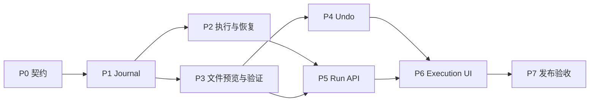

# Monaw v1.1 实施计划

2026-11-03 · 集成分支 `kl/v1.1` · 基线 `main@8d5f9d9`

来源为 [Review Monaw Repository 的最终计划](chatgpt-conversation://6ae5b4c0-d7cc-83ec-9e30-1b1823307ad3)。本文件把原计划的六个交付单元映射到当前 checkout，并给出并行开发用的首版契约。表中的接口、模块和状态是实施目标。

## 1. 版本目标

用户在 Monaw 执行多步骤文件任务时，可以预览修改、暂停执行，并在应用重启后看到已确认完成和仍需核查的操作。只有持久化证据充分、当前权限允许且文件未被后续改动时，界面才提供 Undo。Shell、Browser、MCP 和未纳入验证的文件动作按保守规则记录并处理。SQLite 事务只能约束 Monaw 自己的写入，外部副作用依赖操作级验证。

首个完整切片选用同盘普通文件移动和文本覆盖。其他支持项见文件能力表。计划任务和 Telegram 保留原入口与权限配置，记录恢复风险，桌面 Continue/Undo 只接入桌面任务。计划任务发生未确认副作用时阻止对同一 occurrence 的自动重试；后续 occurrence 继续按既有调度策略处理，若与未解决执行存在冲突则拦截并说明原因。

## 2. 并行实施与分支

`kl/v1.1` 接收各阶段变更。每个开发分支从包含本文件的同一个提交出发；并行实施时给每条轨道单独的 worktree。API、Journal、文件验证器都先按 §3 建立测试替身，真实实现合入后换成真实调用。阶段表区分可以开工与可以合入的时间。

| 阶段 | 本地分支 | 开工依赖 | 合入门槛 | 主要负责区域 |
| --- | --- | --- | --- | --- |
| P0 契约 | `kl/v1.1` | 仓库基线 | 本文件及状态、API、权限和证据契约 | 本文件、roadmap |
| P1 Journal | `kl/v1.1-journal` | P0 | 旧库迁移、原子转换、并发和脱敏测试 | migrations、database、durable store |
| P2 执行接入与恢复 | `kl/v1.1-recovery` | P0，可用 fake Journal | P1；文件核查验收接 P3 | runtime、harness、lifespan、执行入口 |
| P3 文件预览与验证 | `kl/v1.1-file-preview` | P0，可用 fake Journal | P1；先过单元测试，再与 P2 联调真实副作用边界 | file_mutation planner、snapshot、verifier、filesystem |
| P4 Undo | `kl/v1.1-undo` | P0，可用 fake 文件证据 | P3 | undo、文件变更 API、逆操作测试 |
| P5 Run API 和事件 | `kl/v1.1-run-api` | P0，可用 fake controller/store | P1、P2；真实文件恢复能力接 P3 | run routes、控制授权、Run 事件协议 |
| P6 Execution UI | `kl/v1.1-execution-ui` | P0，可用固定 HTTP/SSE 样本 | P4、P5 及真实端到端联调 | frontend/src、Electron 应用测试 |
| P7 发布验收 | `kl/v1.1-release-check` | P0，可先写故障注入驱动 | P2–P6；满足 §5 | 跨模块故障测试、Windows 升级、用户文档 |



图中箭头代表集成依赖。P2 和 P3 可分别合入内部实现，再由 P2 负责把真实 verifier 接到恢复流程。P4 和 P5 可并行合入。P6 可以先独立开发视图与断线逻辑，应用入口在 P4、P5 联通后接线。P7 的进程测试可以随第一条真实写入切片启用。

合并边界：

- P1 独占迁移编号及 SQLite 事务层。P3/P4 若需要增列或索引，由 P1 先更新契约和 migration，再在集成分支同步给下游。
- P2 负责 `runtime.py`、`turn_loop.py`、现有 chat 接入和执行/审批调用边界。P3 负责文件 mutation 服务及原生文件工具内部。二者用 `operation_id` 和明确的 pre-effect hook 接线，文件执行服务只走一次权限及真实写入链。
- P5 负责 Run 路由和控制授权；P4 提供文件路由模块，P5 统一在 `backend/app/api/routes/__init__.py` 注册。P6 负责前端共享类型、SSE 和旧消息视图接线。
- 契约变动先更新本文件及受影响的测试样本，再让各分支同步集成分支。每条分支独立跑本阶段测试，并记录集成后才可验证的用例。先完成真实写入的 Journal → Preview → Crash recovery → Undo 切片，再扩展文件矩阵。

## 3. 共用契约

### 3.1 身份与权限

- 桌面流式入口沿用 [SteeringInbox](../backend/app/agent/steering.py) 的 `run_id`，非流式 desktop job、scheduler 和 Telegram 在受信入口生成或关联 Run ID。客户端提供的桌面 `run_id` 要检查格式及冲突，服务端校验归属。沿用现有 checkpoint `turn_id` 和观测 ID，各自单独关联。
- Continue 沿用 Run，启动新的 turn attempt 和 `turn_id`。保存单调的 attempt 和 revision，用它们隔离旧 worker。新用户指令启动新 Run；用户重试实际写入时分配新的 `operation_id`，关联前一个 operation。审批后的正常回调在同一次 operation 上执行。模型 `tool_call_id` 只用于关联消息和观测。
- Run 保存 `conversation_id`、工作区绑定、执行来源、受信所有者和当前执行会话。Electron [控制会话](../frontend/electron/main.js) 随进程重建。P5 以受信 Electron 主进程和当前 Monaw Home 为跨重启信任边界，给恢复/文件控制使用专用签名能力和 profile 绑定。由主进程和后端在本地建立绑定，客户端输入、路径文本及旧 token 均不可用于声明归属。实时 Stop/Steer 维持现有会话校验。后台来源保留各自权限配置，桌面 token 无法领取其执行权。
- 任何预览读取、Apply、恢复核查、继续、审批或 Undo 都按当前主体和工作区重新校验。状态版本、工作区或预览前置条件变化返回 `409`；权限不足返回 `403`，不可见或不存在的资源统一返回 `404`。审批绑定操作、版本和文件指纹，进程重启或 Pause 后重新申请。

### 3.2 状态机与持久化证据

| 对象 | 状态与转换 |
| --- | --- |
| Run | `running ↔ waiting_approval`。Pause 后 `pausing → paused`，仅在在途副作用已结清且恢复输入可用时进入 `paused`。异常退出进入 `interrupted`，核查后进入 `paused` 或 `needs_review`。`completed`、`failed`、`cancelled` 为终态。 |
| Operation | `prepared → authorized → executing → verified`。确认无副作用的失败可记 `failed`，审批拒绝或执行前跳过记 `cancelled` 并保存原因。执行中断或结果不可判定进入 `uncertain → needs_review`，核查可转 `verified` 或 `failed`，同时保留核查事件。 无法验证外部副作用的工具正常返回时记 `returned`，只表示调用结束。 |
| Effect | `read_only`、`verifiable_write`、`opaque_effect`。未知或混合动作默认为 `opaque_effect`。普通工具返回成功只证明该调用已正常返回，不能作为外部副作用已经核实的证据。 |
| Undo | `available`、`unavailable`、`expired`、`undone`。逆操作有独立 ID、状态和证据。冲突返回 `undo_conflict`，保留当前内容及仍有效的快照。 |

- `agent_runs` 存状态、版本、所有权、attempt、时间、恢复原因及受控恢复输入引用。`run_operations` 存操作 ID、序号、所属 attempt、类别、状态、经过白名单过滤的输入摘要、pre/post 证据和快照引用。`run_events` 存关键状态事件，`(run_id, seq)` 唯一。幂等索引、外键和保留策略纳入 migration 验收。
- 状态转换用事务及版本比较，操作意图先提交，随后在实际副作用入口确认授权、证据和当前 owner，再提交 `executing`。提交失败时停止该写入。结果和事件同事务提交；副作用后写库失败时保留待核查状态。审批、沙箱和并行取消之间遵守同一边界。
- 仅持久化关键事件和必要的回复/恢复输入引用。事件、结果摘要及日志使用字段白名单；秘密、原始批准票据、完整命令或任意工具输入、附件凭据不进公开事件。恢复上下文中已经核实的事实作为工具证据注入，限制内容、大小和来源。缺少安全可恢复输入时关闭 Continue。
- Run 单一 owner 以 `owner_instance_id`、租约及 attempt 核对写入。过期租约只触发检查。仍可能存活的同步线程、子进程或外部任务使相关范围保持阻塞，不能据此宣告暂停完成、释放冲突操作或自动重放。

### 3.3 HTTP 与事件

保留 `/api/chat`、`/api/chat/runs`、旧流式 follow、`/api/chat/stop` 和 `/api/chat/steer` 的行为。新增路由使用 [现有 API 客户端](../frontend/src/lib/api/client.ts) 的鉴权及错误格式。

| 接口 | 首版契约 |
| --- | --- |
| GET `/api/runs?conversation_id=…`、`/api/runs/{id}` | 当前主体可见的 Run 摘要或快照。包含 `run_id`、`conversation_id`、`attempt`、`revision`、`status`、`reason_code`、`available_actions`、`last_seq`。快照与游标来自同一读事务。 |
| GET `/api/runs/{id}/operations`、`/recovery` | 分页操作证据和恢复报告，含操作 ID、原因、允许动作和脱敏证据摘要。 |
| GET `/api/runs/{id}/events?after_seq=N` | 分页补读 `{run_id, seq, type, at, payload}`，按序返回，带 `next_seq`。已清理的游标返回 `410 events_expired`，客户端重新拉快照。 |
| GET `/api/runs/{id}/events/stream?after_seq=N` | 关键事件 SSE，按同一序号从持久化层回放再跟随。连接切换期间补读空档，客户端按 `(run_id, seq)` 去重。旧 chat SSE 继续传 token、审批提示和消息。 |
| POST `/api/runs/{id}/pause`、`/resume`、`/stop` | Pause 等安全边界，Stop 保持终止意图，Resume 建立新 attempt。异步请求返回已接受的状态及新 revision。 |
| POST `/api/runs/{id}/operations/{operation_id}/resolve` | 提交 `verify` 或显式 `skip`。Skip 保留“副作用未知”的审计结论，只有确认风险已隔离且不会重复操作时才重新开放 Continue。重试仅对有安全重试证据的工具开放，需新授权及新 operation。 |
| POST `/api/file-mutations/preview` | 返回绑定当前 Run/会话与工作区的短期 `mutation_id`、版本、文件影响、有限 Diff 或二进制摘要及预计 Undo 能力。 |
| POST `/api/file-mutations/{id}/apply`、`/undo` | 调用同一个服务层和权限门，Apply 消耗一次预览，Undo 仅对已验证的操作开放。来自 Agent 的审批和手动 Apply 共用执行去重，避免执行两次。 |

变更请求带 `Idempotency-Key` 和目标的预期版本。相同主体、动作、资源、键及载荷重试返回原结果，键相同而载荷不同返回 `409 idempotency_conflict`。授权检查先于读取幂等记录；同一操作的并发 Apply/Undo 或 Resume 只有一个成功领取执行权。UI 在收到错误后以服务器状态重新决定动作。

P0 测试样本至少覆盖 `running → pausing → paused → running`、`interrupted → needs_review`、等待审批、并行 operation 状态、游标过期和 Undo 冲突。P5 的契约测试与 P6 的 mock 使用相同字段及原因码；P3 给 P2 提供 before/after/mixed/unknown 文件证据样本。

### 3.4 并行开发测试样本

以下是用于 mock 和契约测试的最小载荷。ID 在 fixture 中可替换。HTTP DTO 的分页外层及其他可选字段由 P5 在接入时补全。

```json
{
  "snapshot": {
    "run_id": "run-a",
    "conversation_id": "chat-a",
    "attempt": 1,
    "revision": 6,
    "status": "needs_review",
    "reason_code": "external_effect_unknown",
    "available_actions": ["inspect", "verify", "stop"],
    "last_seq": 12
  },
  "event": {
    "run_id": "run-a",
    "seq": 13,
    "type": "operation.updated",
    "at": "2026-11-03T01:00:00Z",
    "payload": {"operation_id": "op-2", "status": "verified"}
  },
  "move_evidence": {
    "operation_id": "op-1",
    "source_exists": false,
    "destination_exists": true,
    "destination_identity_matches": true,
    "destination_sha256_matches": true
  }
}
```

- 恢复样本中的 `op-1` 符合同盘移动的已完成条件。`op-2` 仍处于待核查时，快照不含 `resume`。只重放第 13 条事件一次，等待下一条 Run 状态事件或重新取快照，才更新可用动作。
- 将源改为存在，或将目标的身份/指纹匹配改为 false，即构造不能确认已完成的样本。P2 与 P3 用同一组合验证核查结果。
- P4/P6 用“已执行的 post hash 与当前 hash 不同”驱动 `409 undo_conflict`。断线样本用 `410 events_expired` 驱动重新读取快照；`pausing` 样本在 worker 收尾前不开放 `resume`。

## 4. 实施任务与阶段验收

### P1 · Journal 和迁移

P1 的持久化边界由 `Journal` 提供。运行时交接要求确认旧 worker 已结束，租约到期仅触发检查。确认后原子转交给恢复执行者、取消未派发意图，并把执行中的写入记为 `uncertain`。`run_attempts` 保留每次 attempt 的 checkpoint 关联，P2 可通过 `load_turn_checkpoint` 查询。P2 负责证明 worker 已停止并接入实际运行入口，P5 负责路由授权和 HTTP 请求去重。

- 从 [迁移目录](../backend/app/agent/migrations) 的 `0017_turn_checkpoints.sql` 继续，预留 `0018_durable_runs.sql`、`0019_operation_journal.sql`、`0020_run_events.sql`。通过 [迁移 runner](../backend/app/agent/migrations/runner.py) 接入，只有旧库兼容需要时才改 `db_bootstrap.py`。无需回填历史 Run。
- 在 `backend/app/agent/durable/` 建立 `models.py`、`journal.py` 和 `event_store.py`。复用 [database.py](../backend/app/agent/database.py) 的连接和事务方式。保留 `persist_turn_messages` 的 checkpoint 去重，终态与消息提交要么同事务，要么有可恢复的明确顺序和 checkpoint 核对。
- 提供 create/load/claim、operation prepare/transition、snapshot/read-events 接口。测试旧库和新库、事务失败重试、状态及事件同步、并发 seq 与 owner 竞争、删除会话的级联及隐私保留规则。

### P2 · 执行接入、Pause 和恢复

P2 在桌面 SSE、后台 job、计划任务和 Telegram 的共同运行入口创建 durable Run。工具在真正进入处理函数前提交执行意图；原生工具没有 P3 的验证器时按 opaque 记录。启动扫描使用进程锁判断旧 owner，锁无法验证时保留原状态，扫描不重放工具。Pause 与 Continue 在本阶段提供内部入口，Continue 仅用于权限范围仍匹配且可安全重建的桌面 checkpoint。文件效果核查由 P3 接入，公开 Run 控制接口由 P5 接入。

- 以 [runtime.py](../backend/app/agent/runtime.py) 传递 Run/attempt 上下文，[turn_loop.py](../backend/app/agent/turn_loop.py) 只做装配。在 [tool_runner.py](../backend/app/agent/harness/tool_runner.py) 和 [tool_batch.py](../backend/app/agent/harness/tool_batch.py) 为每个实际调用分配 operation，逐个保留结果。检查待审批预检、审批回调和真实工具调用三个路径，在实际写入边界标记 `executing`。
- 在 [turn_lifecycle.py](../backend/app/agent/harness/turn_lifecycle.py) 处理 Pause 请求、收尾和 checkpoint。审批等待时停止新的 dispatch，撤销待处理票据；已有同步任务仍可运行时保持 `pausing` 或进入待核查。Stop、timeout、预算暂停和 Steering 分别保存原因；保留已有部分消息、用量记录和取消语义。
- 在 `durable/operation_policy.py` 和 `durable/recovery.py` 实现分类和核查。通过 [FastAPI lifespan](../backend/app/main.py) 在迁移后、scheduler/Telegram 接收任务前建立恢复屏障。核查只读，外部工具无可用证据时保留未知。用 [turn_restorer.py](../backend/app/agent/harness/turn_restorer.py) 注入已经核实的结果和剩余目标，Continue 走新 attempt，保留当前权限检查和历史消息去重。
- 验收并行一成一断、worker 退出前拒绝替换、审批后崩溃、同一工作区冲突、同一后台 occurrence 无隐式重试、已有 chat 流式和 job 路径保持兼容。用假 verifier 先测生命周期，再以 P3 的同盘移动完成首个真实核查。

### P3 · 文件预览、快照和验证

首批接通的原生操作是普通文件新建与覆盖、同盘移动、普通文件删除。受支持的操作先保存私有证据和必要原始字节，再将 Journal 操作提升为 `verifiable_write`；启动时只读核对身份、父目录和指纹。证据不匹配或当前读取权限撤销时保留待核查状态。Append 和 Patch 的 Dry Run 提供有读取权限的文本 Diff 或元数据摘要，实际写入仍按原流程记录为 opaque。Copy、Rename、目录树、链接、跨盘操作及一次性路径授权沿用原权限流程，不提供快照恢复保证。预览的快照能力是 P4 的输入，公开 Apply/Undo 路由由 P4 接入。

- 在 [filesystem/file_ops.py](../backend/app/skills/filesystem/file_ops.py) 与 [tools.py](../backend/app/skills/filesystem/tools.py) 复用现有目标解析、工作区 scope、`dry_run`、预算和审批逻辑。把计划、有限文本 Unified Diff、快照、执行和验证放到 `backend/app/agent/file_mutation/`。按实现需要拆为 `planner.py`、`diff_engine.py`、`snapshot_store.py`、`executor.py` 和 `verifier.py`。
- 流程为读权限检查 → 生成不可变预览 → 当前权限和审批 → 检查目标身份及指纹 → 提交意图及快照引用 → 执行并验证。Dry Run 只读用户文件，可记录短期预览元数据。Diff 设字节/行数上限，非 UTF-8 按支持的编码生成 Diff，其余给二进制摘要。源/目标均校验，Win 路径别名、reparse point、竞争替换等无法安全约束时拒绝对应操作或撤销能力。
- 保存源/目标身份、存在性、SHA-256 和必要 metadata。快照在受保护的 Monaw Home 内存放，与安装目录分离；使用临时文件、flush 和原子发布，核对 Windows 上可用的持久性。设每文件、总量和保留期限，清理跳过活跃、可恢复或尚有效的引用，回收中途失败留下的孤儿。快照失败时禁止以可撤销模式执行破坏性动作。
- 验收 Dry Run 无目标变更、预览后变更返回 `409 stale_preview`、权限拒绝无内容泄露、磁盘满/限额/崩溃可恢复、同盘移动仅在源缺失且目标身份与指纹匹配时认定已完成。混合状态保留待核查。

| 文件操作 | 首版预览 | P4 Undo 验证目标 |
| --- | --- | --- |
| 新建普通文件 | 路径、预期内容摘要或 Diff | 指纹和身份仍匹配时移除新文件 |
| 覆盖、Append、Patch | 受限 Unified Diff 或摘要 | 还原原内容和受支持 metadata |
| Copy | 来源、目标、是否覆盖 | 移除新副本，或恢复原目标 |
| 同盘 Move/Rename | 来源、目标、覆盖及冲突 | 安全移回并按需恢复原目标 |
| 删除普通文件 | 文件身份、大小、影响 | 原位置仍为空时恢复快照 |
| Mkdir、目录树、跨盘、链接及特殊 metadata | 有界影响摘要；沿用既有权限规则 | 首版标记 `unavailable`；递归删除与目录替换明确显示影响 |

### P4 · Undo 和文件变更 API

当前交付覆盖 P3 已验证的普通文件新建、覆盖、同盘移动及删除的 Undo。逆操作及每个文件步骤有独立持久记录；启动时只读核查失去进程所有者的逆操作，不自动重放。部分完成或证据不明的操作保留待核查状态。按持久 operation ID 可定位 Agent 产生的操作，路径权限、工作区和会话仍须重新验证。

手动预览和 Apply 当前只支持普通单文件写入，要求同一桌面会话中存在活跃 Run。预览及 Apply 的幂等结果保存在进程内，15 分钟过期，重启后不可重放；Undo 的领取和幂等记录持久化。当前控制会话在重启后变化，跨重启的同一 profile 授权及恢复界面仍依赖 P5/P6。Append、Patch、Copy、Rename 等 opaque 操作不提供 Undo；接口没有批量撤销或恢复副本。还原内容和支持的修改时间不保证恢复原文件身份、创建时间或全部 metadata。

新建文件的 Undo 需要安全删除文件，当前仅在 Windows 上启用；其他平台保守地保留文件并标记待核查。恢复临时文件的安全清理也依赖 Windows 句柄；在快照登记之前崩溃可能留下隐藏的临时文件，需要人工核查。

- 在 `file_mutation/undo_manager.py` 编排逆操作，`backend/app/api/routes/file_mutations.py` 暴露预览、Apply、Undo。每次 Undo 重新校验权限、原 operation 状态、快照、文件指纹和源/目标位置，使用新的 Journal 操作。多文件变更按操作逐项撤销和报告，部分失败可核查。
- 覆盖 A→B 后用户写入 C 的冲突场景。返回 `undo_conflict` 并保留 C，界面可显示差异；如提供恢复副本，按新文件写入走独立权限和路径检查。
- 测试矩阵逐项执行和撤销、用户后来编辑或删除、移动源位被占用、权限变化、并发 Undo、快照过期及逆操作中途崩溃。

### P5 · Run API、鉴权和事件回放

已接入 Run 列表、快照、操作证据、恢复报告、事件分页及 SSE，以及 Pause、Resume、Stop 和受限的只读 Verify。控制请求以持久幂等记录和 revision/attempt 约束；中途结果不确定时返回待核查，不自动重放。事件流按持久游标轮询，并检查令牌过期、主体和工作区。Verify 使用当前权限及文件快照证据，写入结论时在事务内重验主体、来源与工作区；未确认风险隔离的 Skip 保持不可用。

Electron 主进程使用操作系统加密保存与 Monaw Home 绑定的 profile，供新建桌面 Run 跨会话恢复；实时 Pause/Stop、审批与附件仍绑定当前会话。无法确认 profile 归属的旧 Run 不自动迁移；系统安全存储不可用或 Linux 仅提供 basic_text 时，不签发恢复身份。跨会话授权和 Resume 已用签名令牌及测试替身覆盖，真实 Electron/后端进程重启的端到端验收留在 P7。

- 新增 `backend/app/api/routes/runs.py`，复用 [chat.py](../backend/app/api/routes/chat.py) 的实时运行入口、[control_plane.py](../backend/app/security/control_plane.py) 的 token 验证和 [run_stream.py](../backend/app/agent/run_stream.py) 的实时交付。明确增加恢复/文件控制的 scope 检查，保留旧路由。持久化关键事件由 P1 提供，P5 接入回放、订阅竞态处理和保留期回退。
- 对接 Electron 的签名能力、P2 的恢复报告和 Pause/Resume 命令。测试同一 profile 重启后访问和接续、其他 profile/会话/工作区的隔离、后台来源隔离、过期审批、重复提交、游标边界，以及慢订阅者断开后补读。

### P6 · Execution UI

已在聊天窗口接入执行状态、服务端允许的 Pause/Continue/Stop、操作详情、恢复核查和文件 Undo；只有服务端检查当前证据、权限及文件状态后返回 `available` 才提供 Undo。审批事件会向当前会话临时传递可信原生文件操作的有限预览，用户在原审批卡片中先查看 Diff 再决定。Run 事件按游标补读、去重并在断线后重连；切换聊天时丢弃旧响应。

支持的预览和 Undo 范围仍以 P3–P5 的文件矩阵、权限和会话规则为准，缺少可信结果时显示待核查。界面恢复涉及的幂等键在 renderer 存储不可用时只能在当前进程中复用。已用隔离 Electron 和真实后端验证 Run/Events 及键盘 Stop；真实进程重启后的完整恢复、Continue 和 Undo 流程仍属于 P7 发布验收。

- 在 `frontend/src/lib/api/` 增加 Run、Operation、Recovery 和 Undo 类型/客户端。用 `useRunController.ts` 管理状态与动作，用 `useRunEvents.ts` 处理重连、补读、去重、旧响应与聊天切换；[useChat.ts](../frontend/src/hooks/useChat.ts) 保留消息与既有实时工具集成。
- 增加 `ExecutionTimeline.tsx`、`RecoveryPanel.tsx` 和 `FileChangePreview.tsx`。从 [MessageBubble.tsx](../frontend/src/components/MessageBubble.tsx) 或会话工具区接入，复用已有 Tool Activity、Execution Plan、审批控件。默认展示当前状态与完成数，详情可展开验证证据、暂停/中断原因及 Undo 可用性。
- 以服务器 `available_actions` 决定按钮。恢复请求在重试时复用幂等键。旧消息与实时事件按身份去重；未知副作用显示在恢复面板，Undo 冲突保留原文件状态。覆盖键盘焦点和可读标签，以及重新打开窗口、切换会话、断线、状态过期、快速双击等交互。

## 5. P7 发布验收

| 必须通过 | 验收证据 |
| --- | --- |
| 进程级崩溃恢复 | 使用隔离 Monaw Home、临时文件与 fake provider。在 intent 前、intent 提交后、真实副作用中、写入成功但结果提交前、结果提交后但消息 checkpoint 前强制终止并重启。逐点检查 DB、文件和 UI；外部写入计数无未经授权的重复。 |
| 并发、审批、权限 | 并行批次一成一断，暂停等在途工具；审批拒绝、授权过期、不同会话与工作区、scheduler 与 Telegram 均有回归。SQL 或快照写失败、不可验证的 Shell/Browser/MCP 保留真实不确定状态。 |
| 文件预览和安全 Undo | 对矩阵中的支持项验证正向结果与逆操作后的内容、metadata。覆盖外部编辑、权限变化、快照空间不足、链接、目标冲突和 Undo 中断。 |
| Electron 完整流程 | 按正常入口开始文件任务、显示 Diff、批准、执行、重启、查看恢复报告、Continue、Undo。另测 Pause/Stop 区别、SSE 断线、双击、旧消息去重和键盘操作。 |
| 升级与现有功能 | 以现有 v1.0 安装及数据库夹具升级。验证历史对话、设置、工作区、调度任务及新 schema，保留原 chat SSE、steer、审批和 job 行为。 |
| 隐私与操作说明 | 检查事件、导出和日志脱敏、会话删除与保留期；在 `docs/api.md`、`docs/operations.md`、`docs/permissions.md` 记录恢复范围、文件矩阵、快照占用与冲突说明。 |

沿用 [仓库验证命令](development.md) 和 [Windows 升级 workflow](../.github/workflows/upgrade-check.yml)。阶段内使用 `uv run --locked pytest` 加目标文件（在 `backend` 下）和 `npx vitest run` 加目标文件（在 `frontend` 下）。集成分支跑 `./scripts/verify.ps1`，Windows 跑 `npm run test:app`、`npm run test:packaged`（先准备安装产物）及升级检查。发布记录保存测试提交 SHA、命令、失败窗口和结果。以上为待执行验收项。

## 6. 第一批可领取任务

1. P1 先落 migration 与 Journal 的事务接口，交付可迁移的旧库 fixture 及重复领取测试。
2. P2 用 fake Journal 实现 attempt、Pause 和并行取消；P3 同时做同盘移动/文本覆盖的证据与快照。
3. P4 用 P0 证据样本实现逆操作；P5 用假 controller 验证版本冲突、幂等和回放；P6 用响应样本开发时间线和恢复面板。
4. P7 编写可从子进程准确停在副作用边界的故障注入驱动。P1–P3 联通后先验证真实崩溃切片，再逐步打开 API 与 UI 操作。
